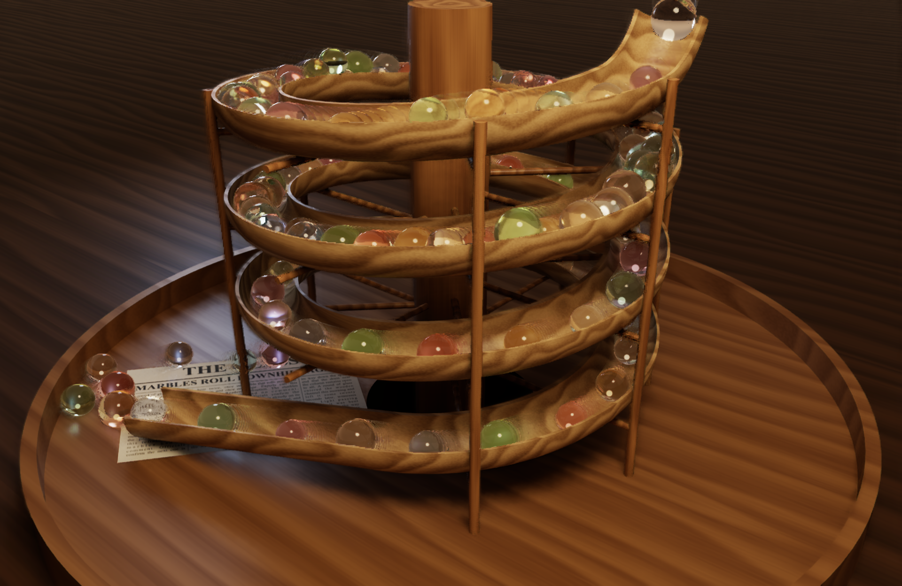
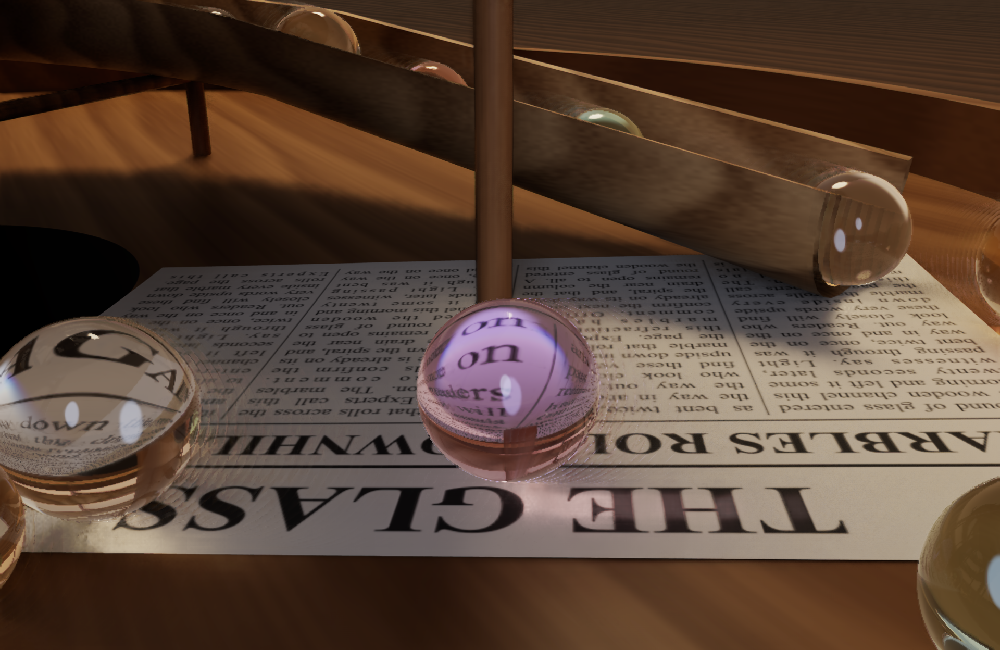

# Glass Marbles

Real-time path traced glass marbles on a wooden track, for Apple silicon Macs with hardware ray tracing.
Built with Swift and Metal; denoising and upscaling use MetalFX. Tested on macOS 27; the reactive mask API it uses is new in that release.

A Rust and Vulkan port for Windows, not yet run on a GPU, is in [rust/](rust/README.md).

## Build and run

    ./build.sh
    open build/GlassMarbles.app

Keys: `[` `]` marble count, `1`-`5` quality, `A` automatic quality, `D` denoiser, `Space` camera, `C` newspaper close-up,
`H` stats, `F` fullscreen, `Esc` quit.

## How it works

- Wood is triangles and marbles are analytic spheres, both in a hardware BVH. The marble level is rebuilt every frame.
- Each pixel traces one path per frame (two on glass), then MetalFX denoises and upscales it.
- Glass contains no randomness. The first hit splits exactly into reflection and refraction, and surfaces seen through a
  marble get fixed lighting (one shadow ray to the centre of each light, plus a constant for indirect light). That noise-free
  result skips the denoiser through a strength mask, because the denoiser erases the detail that makes glass look clear.
  This is an approximation: internal reflections are simplified and shadows seen through glass are hard.
- Caustics are approximated: a shadow ray through a marble treats it as a thick lens. They are not true light transport.
- A made-up newspaper page, drawn with Core Text at startup, lies on the marbles' path so the refraction can be judged against print.
- Marble physics runs on the CPU with a uniform grid.

## Benchmark

Runs without a window or vsync, so it reports what the GPU can really do:

    build/GlassMarbles.app/Contents/MacOS/GlassMarbles --benchmark 600 --tier medium --marbles 150 --csv out.csv

Other options: `--no-denoise`, `--size WxH`, `--png file.png`, `--png-after N`, `--pause-camera`, `--log`, `--closeup`, `--quit-after S`.

## Measured results

MacBook Air M4 (10-core GPU, 16 GB), on battery, 42k triangles, window size 2560x1664.

Without a window or vsync, display off:

| Tier | Traced -> output | Bounces | FPS |
|---|---|---|---|
| cinematic | 1280x832 -> 2560x1664 | 14 | 27 |
| high | 960x624 -> 1920x1248 | 12 | 49 |
| medium | 960x624 -> 1920x1248 | 8 | 61-70 cold, about 56 after 5+ minutes |
| low | 720x468 -> 1440x936 | 6 | 112 cold, 118 warm |

Marble count, medium tier, cold: 50: 88 FPS; 150: 64; 600: 59; 2400: 37.

Measured with the current glass and newspaper: medium 61 FPS, medium in the close-up 54 FPS, balanced 78 FPS before the newspaper
was added. Everything else in these tables, including the 10-minute heat test, was measured with an earlier glass implementation.
Treat those as approximate.

Short runs vary by about 10%. Raw data is in `results/`.

In the window, auto quality steers by delivered frames, because under vsync the GPU lowers its clock and GPU time stops
showing headroom. It tries `high` from time to time, so expect about 4 seconds at 47-50 FPS on each try; the wait between
tries doubles each time, up to 5 minutes. Quality stays put while the window is covered, since macOS then draws it less often.

A 168-second window run averaged 58.0 FPS (58.8 in the seconds when the window was visible). Its lowest second was 47.2 FPS,
during a try of `high`. The app opts out of App Nap, which had caused dips to about 13 FPS while the window was covered.

Not tested: the keyboard controls, and a long heat run in the window.

## Known limitations

- Moving marbles have a faint rippled fringe at their edges, where denoised and undenoised pixels meet.
- Refraction is exact for the path through the ball, but internal reflections and shadows seen through glass are simplified.
